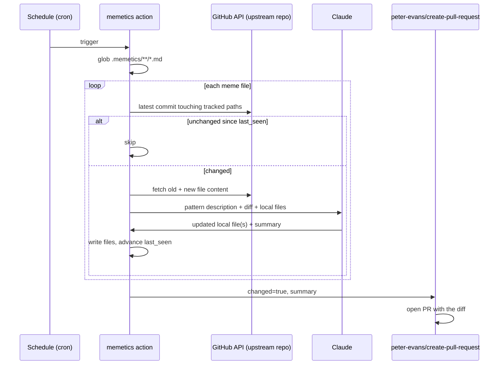

# How it works

Memetics ships as a single composite [GitHub Action](https://github.com/GeorgePearse/memetics)
(`action.yml` + `scan_and_update.py`). It does **detection and drafting**
only — PR creation is left to [`peter-evans/create-pull-request`](https://github.com/peter-evans/create-pull-request),
a battle-tested action already trusted for exactly this job, rather than
reinventing git/PR plumbing.

## 1. Discovery

The action globs for meme files (default `.memetics/**/*.md`, configurable
via the `paths` input) and parses each one's YAML frontmatter — see
[file format](file-format.md).

## 2. Change detection

For each `upstream` entry, it calls
`GET /repos/{repo}/commits?path=...&sha=<ref>` for every tracked path and
takes the most recent commit across all of them. If that SHA matches
`last_seen`, nothing happened — move on. This is a single REST call per
tracked path, so a meme file with a handful of upstream paths costs a
handful of API calls, no cloning required.

## 3. Diffing

When the latest SHA differs from `last_seen`, the action fetches the tracked
file's content at both the old and new SHA (`GET /repos/{repo}/contents/{path}?ref=...`)
and compares them. A commit can touch a path without changing a specific
file (e.g. unrelated changes in the same directory with a path filter that's
too broad) — those are detected and skipped so they don't trigger a no-op PR.

## 4. Drafting the update

If there's a real diff, the action builds one prompt containing:

- the meme file's Markdown body (the human-authored description and
  adaptation notes),
- the upstream before/after content for every changed path,
- the current content of every file listed under `local.paths`.

It asks Claude for a structured response (`output_config.format` with a
JSON schema: a list of `{path, content}` files to write, plus a one-paragraph
summary) — not free text to parse. The model is instructed to change only
what the upstream diff actually motivates, and to respect the pattern
description's own constraints (e.g. "keep this API stable").

## 5. Writing the result

Each returned file is written to disk at its given path, and the meme
file's `last_seen` is advanced to the new SHA — whether or not Claude
produced changes, so a path that merely got touched (no real diff) doesn't
get re-checked forever.

## 6. Opening the PR

The action's `changed` output gates a `peter-evans/create-pull-request` step
in the consumer's own workflow, using the action's `summary` output as the
PR body. The actual commit, branch, and PR creation are handled by that
action — Memetics never touches git directly.

## Why an LLM-authored diff instead of just a notification

A plain "upstream changed, go check" notification still requires a human to
re-derive the adaptation from scratch every time. Memetics instead gives
Claude the same context a human would gather by hand — the diff, the
original rationale, the current code — and lets it draft the mechanical part
of the update. The PR is still reviewed by a human before merge; the value
is turning "notice drift" into "evaluate a draft," not full automation.
