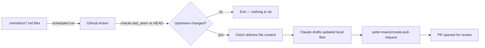

# Memetics

Dependabot watches your dependency *versions*. Memetics watches your dependency
*ideas* — the implementation patterns you borrowed from somewhere, wrote your
own version of, and now have no way of knowing have drifted.

You describe one bit of functionality in a small Markdown file: what it is,
optionally a diagram or screenshot, and where it came from upstream — one
repo, or several, if it's the same idea reimplemented across frameworks.
Memetics runs on a schedule, checks whether anything at those upstream
locations has changed since it last looked, and if so, asks Claude to draft
a PR updating your local implementation to match — complete with a summary
of what changed and why.

## Why

- **Dependabot updates the library. Nothing updates the code you wrote
  because of the library.** If you reimplemented a pattern instead of
  importing it — for license reasons, to adapt it to your framework, or
  because it was simpler than adding a dependency — Dependabot has nothing to
  bump. Memetics tracks the pattern itself.
- **One pattern, many upstreams.** The same idea might exist in two
  frameworks you watch (e.g. `react-window` and `@tanstack/virtual` for
  virtual scrolling). A meme file can track either, or both.
- **The LLM writes the diff, not just a notification.** Instead of "upstream
  changed, go look," you get an actual PR with the adaptation already drafted
  against your code's existing style.

## Where to go next

- [Quickstart](quickstart.md) — add the action to a repo in a few minutes.
- [Meme file format](file-format.md) — the full `.memetics/*.md` schema.
- [How it works](how-it-works.md) — detection, diffing, and PR generation in
  detail.
